# MapLibre Flutter

[](https://pub.dev/packages/maplibre)
[](https://github.com/josxha/flutter-maplibre)
[](https://pub.dev/packages/maplibre)
[](https://pub.dev/packages/maplibre/score)
[](https://pub.dev/packages/maplibre)

[](https://codecov.io/gh/josxha/flutter-maplibre)
[](https://pub.dev/packages/very_good_analysis)

Interactive vector maps for Flutter on Android, iOS, macOS, Windows, Linux and
web, built on [MapLibre](https://maplibre.org). Show any MapLibre or Mapbox
compatible style, from any tile provider or your own server. `maplibre` needs
no API key of its own; keys and fees depend only on the tile provider you
choose.

<p align="center">
  <a href="https://josxha.github.io/flutter-maplibre/demo">
    
  </a>
  <a href="https://josxha.github.io/flutter-maplibre/demo">
    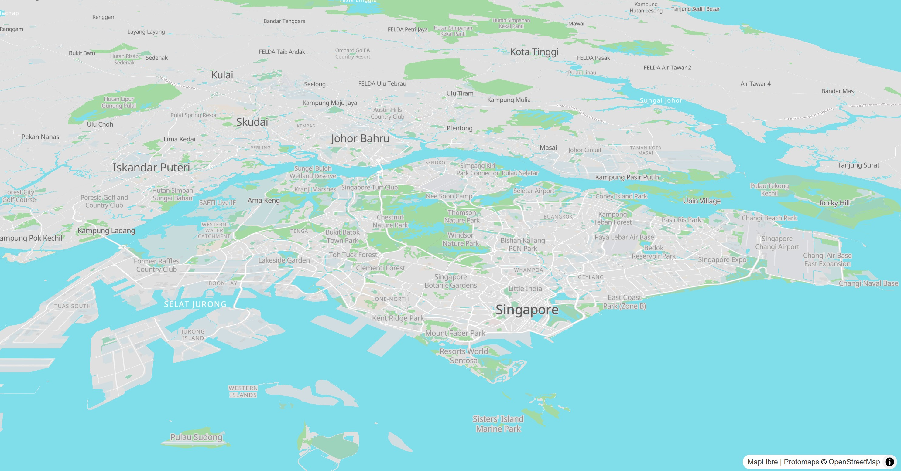
  </a>
</p>

<p align="center">
  <a href="https://josxha.github.io/flutter-maplibre/docs/getting-started/setup/"><b>Get started</b></a> ·
  <a href="https://josxha.github.io/flutter-maplibre/demo"><b>Live demo</b></a> ·
  <a href="https://josxha.github.io/flutter-maplibre/docs/"><b>Documentation</b></a> ·
  <a href="https://pub.dev/documentation/maplibre/latest/maplibre/"><b>API reference</b></a>
</p>

## Features

- **Six platforms, one API**: Android, iOS, macOS, Windows, Linux and web,
  with the same gestures and behavior everywhere.
- **Flutter first**: maps render into a Flutter `Texture` (an HTML element on
  web), so widgets over and around the map compose like any other widget. Annotations are declarative
  layers that you update with `setState()`.
- **Fast interop**: calls MapLibre through FFI (and maplibre-gl-js through JS
  interop on web) instead of platform channels, and many values, such as the
  camera and the style layers, can be read synchronously.
- **The full style spec**: typed style layers, sources and expressions, vector
  and raster tiles, PMTiles, MBTiles, MapLibre Tiles (MLT), hillshading,
  heatmaps and 3D extrusions.
- **Offline maps**: download regions or the tiles along a route.
- **Batteries included**: user location, compass, scale bar, attribution, zoom
  buttons, clustering, feature queries and events for taps, drags and hover.

## Quick start

```dart
import 'package:maplibre/maplibre.dart';

MapLibreMap(
  options: MapOptions(
    style: MapStyle.url('https://demotiles.maplibre.org/style.json'),
    initCamera: .position(center: Geographic(lon: 9.17, lat: 47.68), zoom: 7),
  ),
  layers: [
    CircleLayer(
      points: [Feature(geometry: Point(Geographic(lon: 9.17, lat: 47.68)))],
      color: const .literal(Colors.blue),
      radius: const .literal(12),
    ),
  ],
)
```

See [Installation](https://josxha.github.io/flutter-maplibre/docs/getting-started/setup/)
and [Platform setup](https://josxha.github.io/flutter-maplibre/docs/getting-started/platforms/)
for the steps each platform needs.

## Platforms

| Platform | Package           | Rendering                              |
|----------|-------------------|----------------------------------------|
| Android  | `maplibre_native` | OpenGL ES 3.0 (default) or Vulkan      |
| iOS      | `maplibre_native` | Metal                                  |
| macOS    | `maplibre_native` | Metal                                  |
| Windows  | `maplibre_native` | Vulkan, shared with Flutter via D3D11  |
| Linux    | `maplibre_native` | Vulkan, shared with Flutter via OpenGL |
| Web      | `maplibre_web`    | WebGL 2 (maplibre-gl-js)               |

`maplibre_native` uses the
[C API of MapLibre Native](https://github.com/maplibre/maplibre-native-ffi)
through the [maplibre_native_ffi](https://pub.dev/packages/maplibre_native_ffi)
binding. `maplibre_web` uses
[maplibre-gl-js](https://github.com/maplibre/maplibre-gl-js). You only add
`maplibre` to your app.

## maplibre or maplibre_gl?

There are two Flutter packages for MapLibre. They take different approaches:

|                 | `maplibre` (this package)                                   | `maplibre_gl`                                                   |
|-----------------|-------------------------------------------------------------|-----------------------------------------------------------------|
| Principle       | What can be done in Dart is done in Dart                    | What the MapLibre SDKs can do is done by the SDKs               |
| Platforms       | Android, iOS, macOS, Windows, Linux, web                    | Android, iOS, web                                               |
| Interop         | FFI, JS interop on web                                      | Platform channels, JS interop on web                            |
| Map in Flutter  | `Texture`, HTML element on web                              | Platform view, HTML element on web                              |
| API             | Declarative annotations and an imperative controller, synchronous where possible | Imperative controller, asynchronous                             |

The
[comparison](https://josxha.github.io/flutter-maplibre/compare/) covers other map
packages as well.

## ❤️ Development & Contributing

All kinds of contributions are welcome. Thanks a lot if you consider to
contribute in any way! There are different ways how you can help the
development:

- 🌟 Give the project on [GitHub](https://github.com/josxha/flutter-maplibre) a
  star and like it on [pub.dev](https://pub.dev/packages/maplibre). This helps
  the package to grow!
- 🪴 Use the package in your project
  and [share feedback](https://github.com/josxha/flutter-maplibre/discussions/categories/show-and-tell).
- 🐛
  Open [bug reports](https://github.com/josxha/flutter-maplibre/issues/new?assignees=&labels=bug&projects=&template=1-bug.yml)
  in case you find any.
- 💡 If you need a specific
  feature, [open a feature request](https://github.com/josxha/flutter-maplibre/issues/new?assignees=&labels=feature&projects=&template=2-feature.yml&title=%5BFEATURE%5D+%3Ctitle%3E).
  or [post your idea as discussion](https://github.com/josxha/flutter-maplibre/discussions/categories/ideas).
- 💬 Use the [invite link](https://slack.openstreetmap.us) to chat with us on Slack in the `#flutter-maplibre` channel.
- 📖 Enhance the package documentation.
- 💝 Sponsor this
  project: [GitHub-Sponsors](https://github.com/sponsors/josxha), [PayPal](https://www.paypal.com/paypalme/joschaeckert).

## 👀 Preview Images

<table>
  <tbody>
    <tr>
      <td style="text-align: center;">
        <strong>Globe View</strong>
        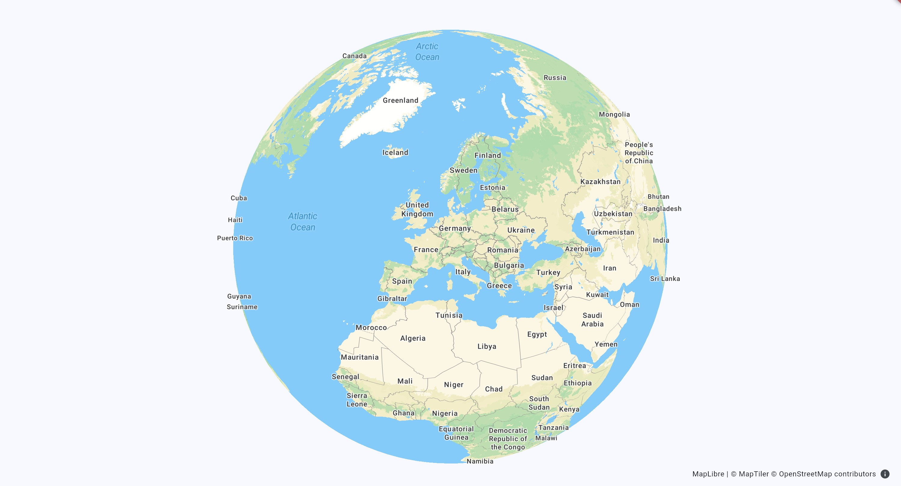
      </td>
      <td style="text-align: center;">
        <strong>Custom Styling</strong>
        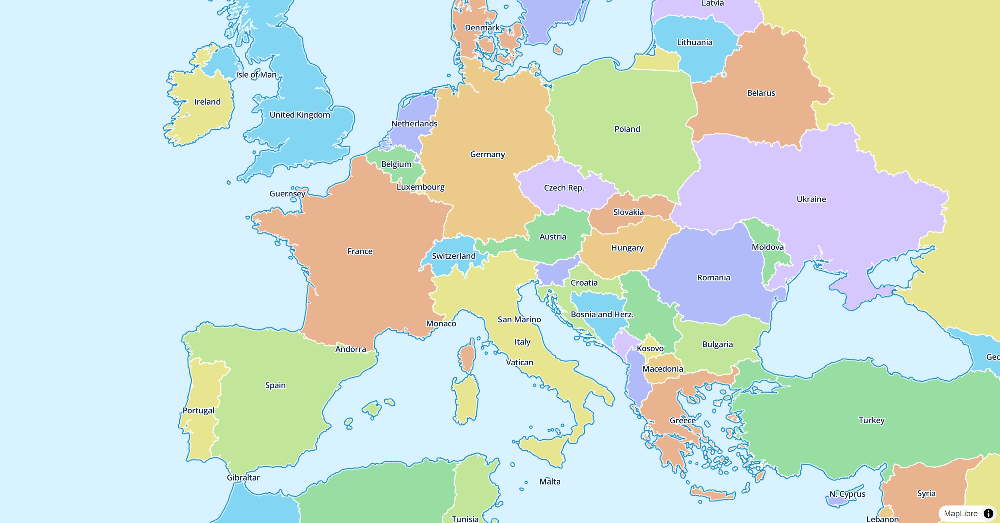
      </td>
      <td style="text-align: center;">
        <strong>Pitch and Rotate</strong>
        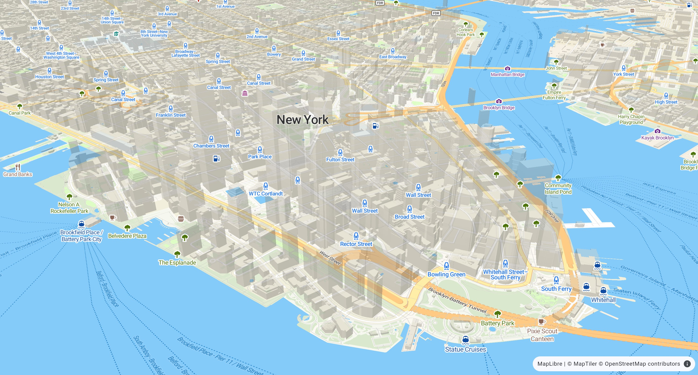
      </td>
    </tr>
    <tr>
      <td style="text-align: center;">
        <strong>Raster Tiles</strong>
        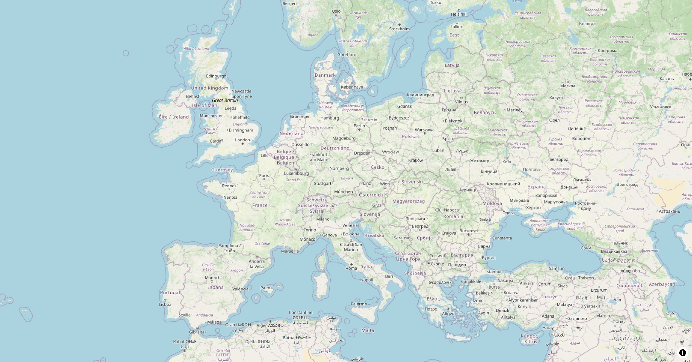
      </td>
      <td style="text-align: center;">
        <strong>3D Building Outlines</strong>
        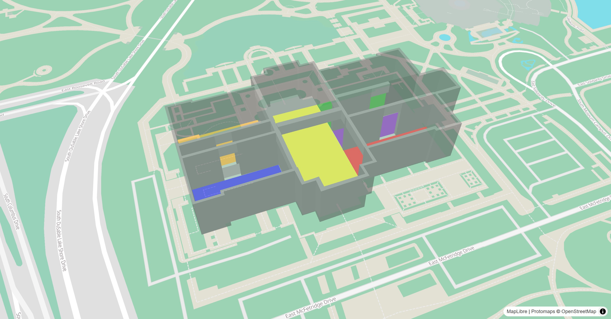
      </td>
      <td style="text-align: center;">
        <strong>Heatmaps</strong>
        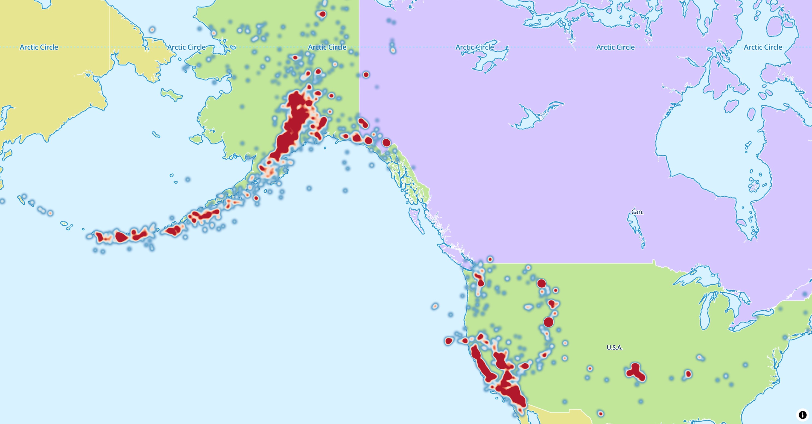
      </td>
    </tr>
    <tr>
      <td style="text-align: center;">
        <strong>Polygons</strong>
        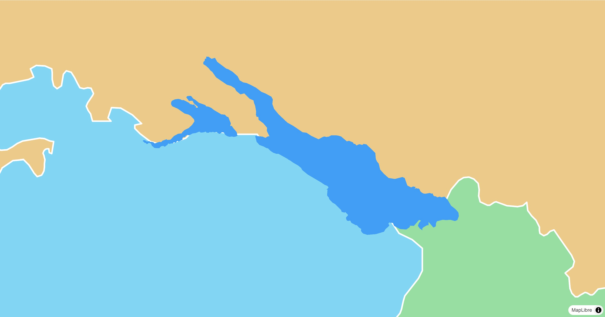
      </td>
      <td style="text-align: center;">
        <strong>Elevation</strong>
        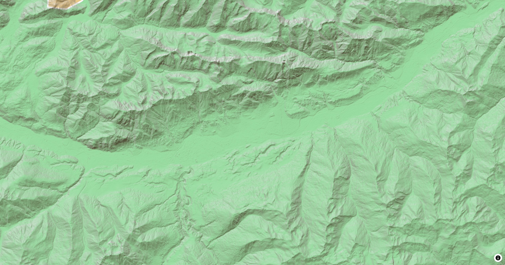
      </td>
      <td style="text-align: center;">
        <strong>Lines</strong>
        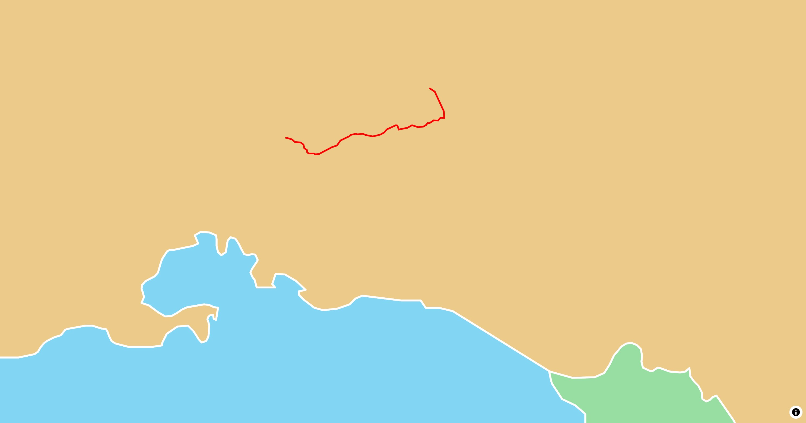
      </td>
    </tr>
    <tr>
      <td style="text-align: center;">
        <strong>Circles</strong>
        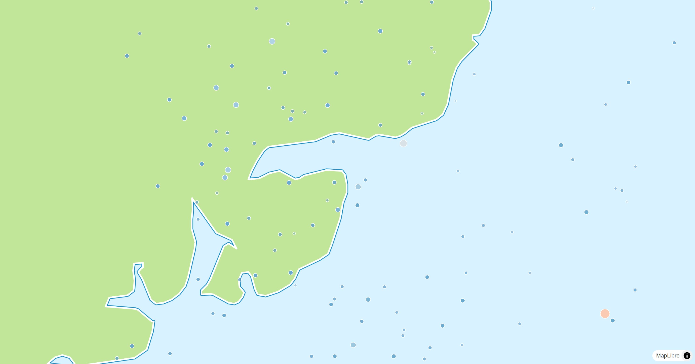
      </td>
      <td style="text-align: center;">
        <strong>Markers</strong>
        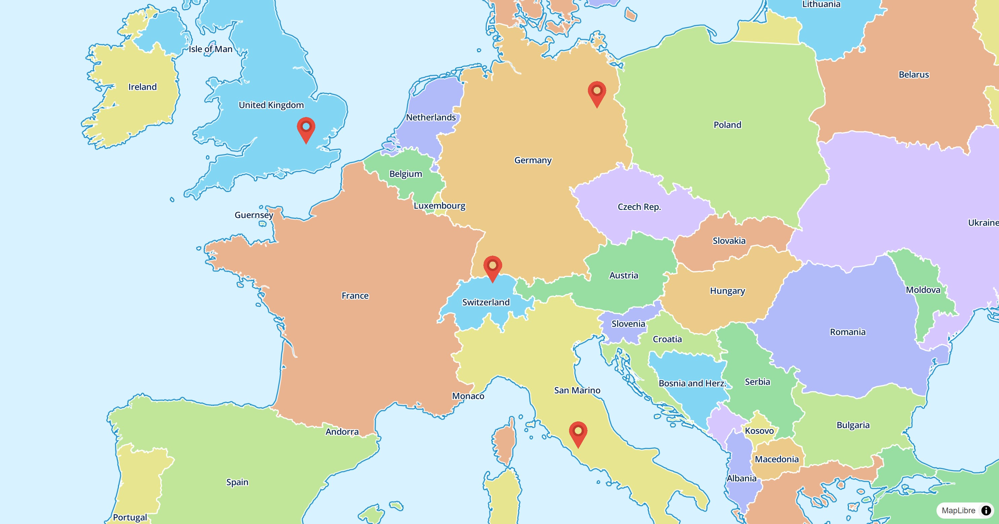
      </td>
      <td style="text-align: center;">
      </td>
    </tr>
  </tbody>
</table>

## 😎 A huge thanks to all contributors!

[](https://github.com/josxha/flutter-maplibre/graphs/contributors)