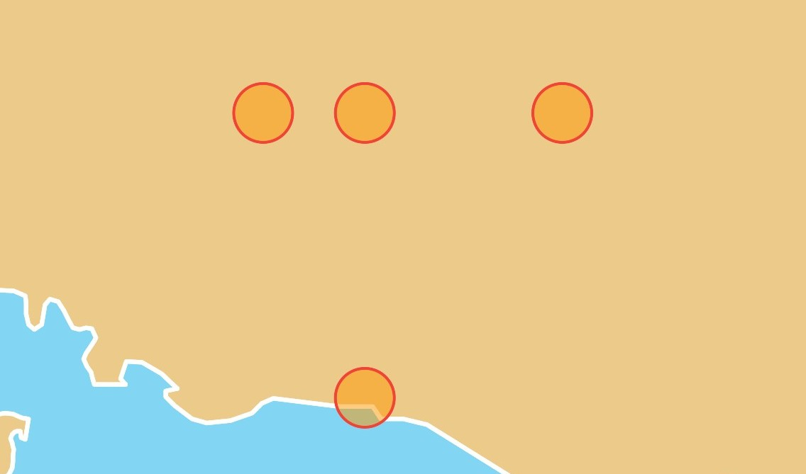
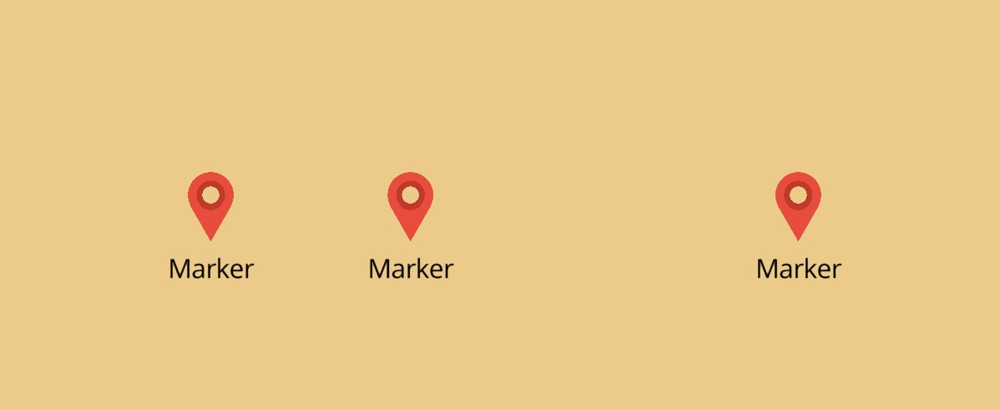
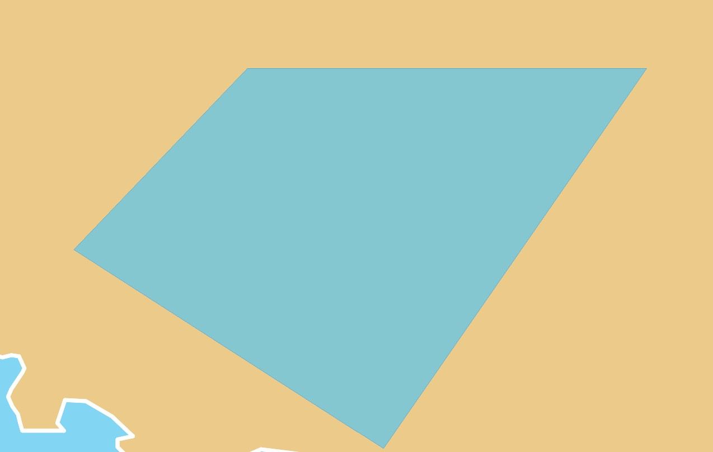
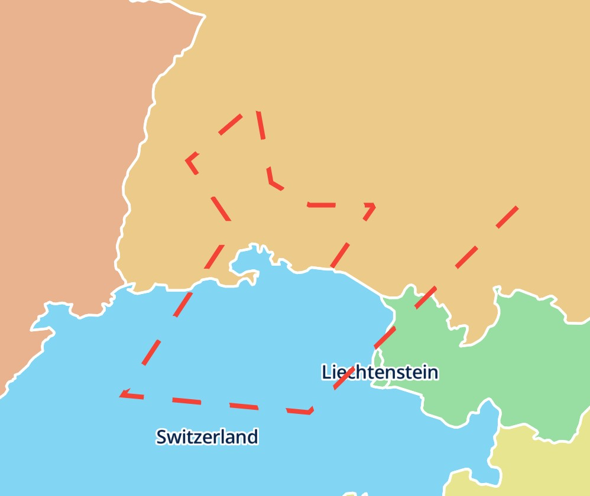

# Annotation Layers

Annotation layers show your own points, lines and areas on the map. Put them
in the `MapLibreMap.layers` list and change them like any other widget
parameter, with `setState()` or the state management of your choice. The map
adds, updates and removes only what changed.

| Layer                         | Geometry       | Built on                                                       |
|-------------------------------|----------------|----------------------------------------------------------------|
| [`CircleLayer`](#circles)     | `Point`        | [`CircleStyleLayer`](../style-layers/index.md#circle)          |
| [`MarkerLayer`](#markers)     | `Point`        | [`SymbolStyleLayer`](../style-layers/index.md#symbol)          |
| [`PolygonLayer`](#polygons)   | `Polygon`      | [`FillStyleLayer`](../style-layers/index.md#fill)              |
| [`PolylineLayer`](#polylines) | `LineString`   | [`LineStyleLayer`](../style-layers/index.md#line)              |

Flutter widgets on the map go into a [`WidgetLayer`](widgets.md). For large or
frequently changing data, add a [source](../sources/index.md) and a
[style layer](../style-layers/index.md) to the style instead.

## Circles

<a href="../../demo/#/layers/circle">

</a>

```dart linenums="1" hl_lines="5-16"
@override
Widget build(BuildContext context) {
  return MapLibreMap(
    options: MapOptions(initCamera: .position(center: Geographic(lon: 9.17, lat: 47.68), zoom: 7)),
    layers: [
      CircleLayer(
        points: const [
          Feature(geometry: Point(Geographic(lon: 9.17, lat: 47.68))),
          Feature(geometry: Point(Geographic(lon: 9.17, lat: 48))),
          Feature(geometry: Point(Geographic(lon: 9, lat: 48))),
          Feature(geometry: Point(Geographic(lon: 9.5, lat: 48))),
        ],
        color: .literal(Colors.orange.withValues(alpha: 0.5)),
        radius: const .literal(20),
        strokeColor: const .literal(Colors.red),
        strokeWidth: const .literal(2),
      ),
    ],
  );
}
```

See the
[example app](https://github.com/josxha/flutter-maplibre/blob/main/examples/lib/layers_circle_page.dart).

## Markers

<a href="../../demo/#/layers/marker">

</a>

Markers show an icon, a label or both. The `icon` of the layer is its image,
which the map adds to the style for it:

```dart linenums="1" hl_lines="13-20"
final _points = <Feature<Point>>[
  const Feature(geometry: Point(Geographic(lon: 9.17, lat: 47.68))),
  const Feature(geometry: Point(Geographic(lon: 9, lat: 48))),
];

@override
Widget build(BuildContext context) {
  return MapLibreMap(
    options: MapOptions(initCamera: .position(center: Geographic(lon: 9.17, lat: 47.68), zoom: 7)),
    // add a marker where the user taps
    onClick: (event) =>
        setState(() => _points.add(Feature(geometry: Point(event.point)))),
    layers: [
      MarkerLayer(
        points: _points,
        icon: const .iconData(Icons.location_on, color: Colors.red),
        textField: const .literal('Marker'),
        textAllowOverlap: const .literal(true),
        iconAnchor: const .literal(IconAnchor.bottom),
        textOffset: const .literal(Offset(0, 1)),
      ),
    ],
  );
}
```

A `MarkerIcon` is one of:

| Icon                                     | Image                                                   |
|------------------------------------------|---------------------------------------------------------|
| `.iconData(Icons.place, color:, size:)`  | An icon font glyph, `size` logical pixels large (48)    |
| `.asset('assets/pin.png', pixelRatio:)`  | A Flutter asset                                         |
| `.bytes(pngBytes, pixelRatio:)`          | Encoded image bytes, such as a PNG                      |
| `.provider(NetworkImage(url))`           | Any `ImageProvider`, at the scale of the image it loads |
| `.named('pin')`                          | An image the style already has, from its sprite or `addImage` |
| `.expression(Expression.get('icon').asString())` | Per feature, an image the style already has |

The map adds each image once, shares it between the layers with an equal
icon, removes it once no layer shows it, and adds it again when another style
loads.

See the
[example app](https://github.com/josxha/flutter-maplibre/blob/main/examples/lib/layers_marker_page.dart).

## Polygons

<a href="../../demo/#/layers/polygon">

</a>

```dart linenums="1" hl_lines="5-23"
@override
Widget build(BuildContext context) {
  return MapLibreMap(
    options: MapOptions(initCamera: .position(center: Geographic(lon: 9.17, lat: 47.68), zoom: 7)),
    layers: [
      PolygonLayer(
        polygons: [
          Feature(
            geometry: Polygon.from(const [
              [
                Geographic(lon: 8.2013, lat: 48.1074),
                Geographic(lon: 8.8853, lat: 48.0943),
                Geographic(lon: 8.7597, lat: 47.6933),
                Geographic(lon: 9.6320, lat: 48.0893),
                Geographic(lon: 8.6854, lat: 48.4538),
                Geographic(lon: 8.2013, lat: 48.1074),
              ],
            ]),
          ),
        ],
        color: .literal(Colors.lightBlueAccent.withValues(alpha: 0.6)),
        outlineColor: const .literal(Colors.blue),
      ),
    ],
  );
}
```

See the
[example app](https://github.com/josxha/flutter-maplibre/blob/main/examples/lib/layers_polygon_page.dart).

## Polylines

<a href="../../demo/#/layers/polyline">

</a>

```dart linenums="1" hl_lines="5-19"
@override
Widget build(BuildContext context) {
  return MapLibreMap(
    options: MapOptions(initCamera: .position(center: Geographic(lon: 9.17, lat: 47.68), zoom: 7)),
    layers: [
      PolylineLayer(
        polylines: [
          Feature(
            geometry: LineString.from(const [
              Geographic(lon: 9.17, lat: 47.68),
              Geographic(lon: 9.5, lat: 48),
              Geographic(lon: 9, lat: 48),
            ]),
          ),
        ],
        color: const .literal(Colors.red),
        width: const .literal(4),
        blur: const .literal(3),
        dashArray: const .literal([5, 5]),
      ),
    ],
  );
}
```

See the
[example app](https://github.com/josxha/flutter-maplibre/blob/main/examples/lib/layers_polyline_page.dart).

## Ids

Every annotation layer is a style layer with a GeoJSON source of the same id.
Set `id` to name them:

```dart
CircleLayer(id: 'stops', points: stops)
```

The id must not be in use by a layer or source of the style, or by another
layer of the list. It also tells a rebuild which layer is which, like a `Key`
of a widget: a layer with an id keeps its style layer and source wherever it
moves in the list. Layers without an id match the next layer of the same type
without an id, in the order of the list.

Read and query the style layers by these ids, for example with
`queryRenderedFeatures(layerIds: ['stops'])`. Change them only through
`MapLibreMap.layers`: `style.layers.remove()` and `.move()` fail for them, and
their setters warn in debug builds, as the next rebuild would undo the
change.

## Order and anchors

The layers draw in the order of the list, the first at the bottom, like the
children of a `Stack`. A reordered list moves the style layers. By default the
annotation layers go on top of the style. `anchor` places a layer elsewhere:

```dart
PolylineLayer(
  polylines: routes,
  // below the labels of the style
  anchor: const .below('road-label'),
)
```

| Anchor              | Place                                     |
|---------------------|-------------------------------------------|
| `.top()`            | Above every layer of the style (default)  |
| `.bottom()`         | Below every layer of the style            |
| `.below('layerId')` | Right below the style layer `layerId`     |
| `.above('layerId')` | Right above the style layer `layerId`     |

Layers with the same anchor keep the order of the list among themselves.
`.below()` and `.above()` name a layer of the style, not one of the list. If
the current style has no such layer, the layer goes on top and debug builds
print a warning.

The layers, their sources and their icons stay on the map when another style
loads.

## Style each feature

Every style parameter is an [expression](../style-layers/expressions.md), so
it can depend on the properties of each feature:

```dart
CircleLayer(
  points: points,
  radius: .get('size').asNumber(),
  color: .get('color').convertToColor(),
)
```

A map can show any number of annotation layers, each with its own style. For
properties that the annotation layers don't have, use the
[style layer](../style-layers/index.md) they are built on.

## Interaction

- [Click and Hover](click-and-hover.md): react to taps and the mouse on
  features.
- [Drag](drag.md): let the user move features.
