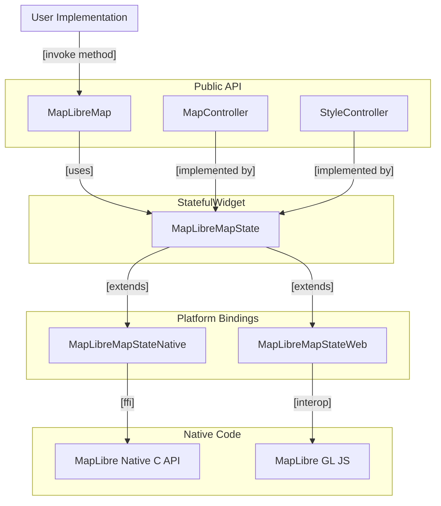

# Architecture Overview

This page gives a small introduction in the architecture that is used
for `maplibre`.

## Abstraction Layers

`maplibre` is a federated plugin with two implementations: `maplibre_web`
uses MapLibre GL JS in the browser, and `maplibre_native` uses MapLibre Native
through its C API everywhere else. `maplibre_native` renders each map into a
GPU texture and shows it with Flutter's `Texture` widget, so maps compose with
other widgets like any other part of the widget tree.

### 1. Public API

`MapLibreMap` and `MapController` is part of the public API. That part of the
package that users are in contact with.

### 2. MapLibreMapState

`MapLibreMapState` is an abstract base class for the `State<MapLibreMap`> and
contains implementations that are completely platform invariant.

### 3. MapLibreMapStateNative, -Web

This is the last Flutter/Dart layer. These classes contain missing
implementations that haven't previously been implemented on an higher level.

This layer has the connection with the Native Code Layer using

- FFI through the generated `maplibre_native_ffi` binding of the MapLibre
  Native C API, plus a small platform plugin that registers the Flutter
  texture.
- The WASM compatible interop with JavaScript using js_interop and package:web
  on Web.

### 4. Native Layer

The last and most low level layer that package uses: the MapLibre Native C
library, which renders into a texture that the platform plugin registers with
Flutter, or MapLibre GL JS on web.
