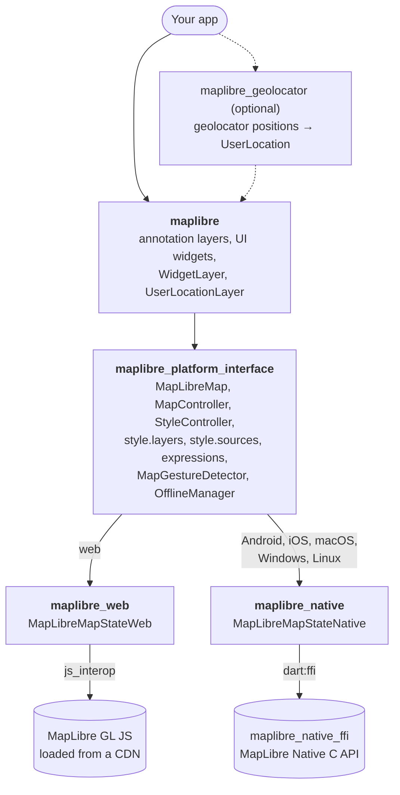
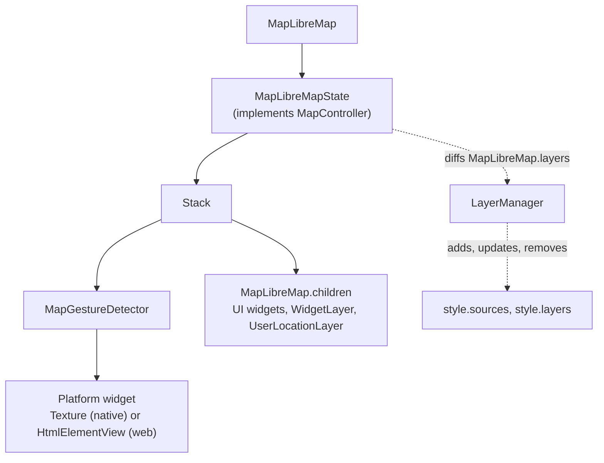
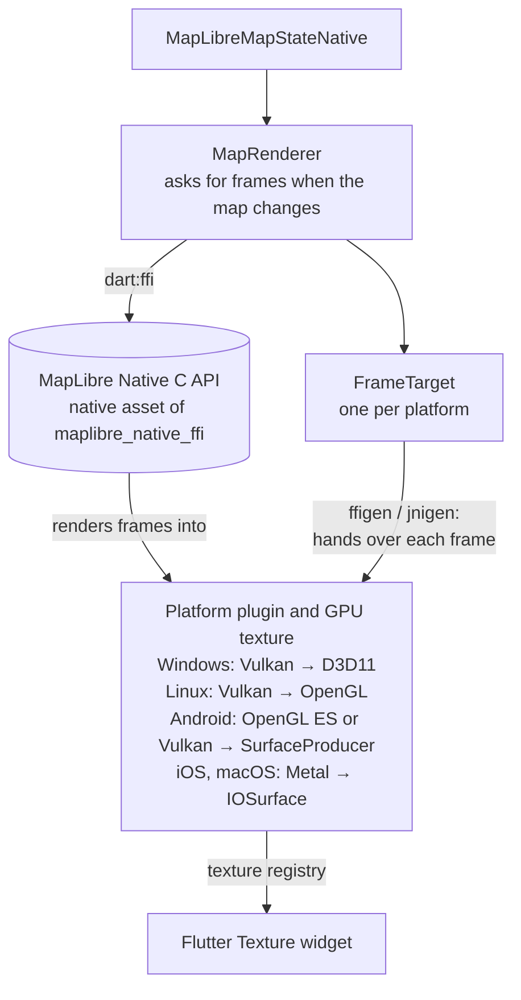

# Architecture

`maplibre` is a [federated plugin](https://docs.flutter.dev/packages-and-plugins/developing-packages#federated-plugins)
with two implementations: `maplibre_web` uses MapLibre GL JS in the browser,
and `maplibre_native` uses MapLibre Native through its C API on every other
platform. Both implement the same interface, so apps only use `maplibre`.

## Packages

| Package                       | Content                                                                                                     |
|-------------------------------|-------------------------------------------------------------------------------------------------------------|
| `maplibre`                    | What apps import: the annotation layers, UI widgets, `WidgetLayer` and `UserLocationLayer`, and everything of the platform interface. |
| `maplibre_platform_interface` | `MapLibreMap`, the `MapController` and `StyleController` interfaces, `MapLibreMapState`, the style layers, sources and expressions, the `OfflineManager` interface and the gesture recognizer. |
| `maplibre_web`                | `MapLibreMapStateWeb`: binds MapLibre GL JS with `js_interop` and loads it on the first map.                |
| `maplibre_native`             | `MapLibreMapStateNative`: drives MapLibre Native through `maplibre_native_ffi` and shows its frames in a Flutter texture. |
| `maplibre_geolocator`         | Turns `geolocator` positions into the `UserLocation` stream of a `UserLocationLayer`.                      |

## Map widget

`MapLibreMap` creates the `MapLibreMapState` of the platform. The state is
the `MapController` of the map, and builds the same tree on every platform:

- **Gestures** are recognized once, in `MapGestureDetector`, for every
  platform. It hands screen-space camera steps to a `GestureCameraSink`, which
  each platform implements with its own camera engine. Widgets in `children`
  sit above it, so they receive their own pointers first.
- **Annotation layers** in `MapLibreMap.layers` are turned into GeoJSON
  sources and style layers by the `LayerManager`, which only updates what
  changed between builds.
- **Style changes** go through `style.layers` and `style.sources`. They keep
  the state of the style in Dart, so reads are synchronous, and pass changes
  to the platform through a small `StyleBackend` interface.

## Native rendering

On Android, iOS, macOS, Windows and Linux, MapLibre Native renders each map
off screen into a GPU texture, and Flutter shows it with a `Texture` widget.
No platform views are used, so maps compose with other widgets like any
other part of the widget tree.

1. `MapRenderer` owns the map and its render session in the C library, and
   asks for a frame whenever the map changed.
2. MapLibre Native renders the frame on its own thread into the render target
   of the platform.
3. The `FrameTarget` of the platform hands the frame to its plugin, which
   marks the Flutter texture as updated. Where the platform allows it, the
   frame is shared with Flutter on the GPU, without a CPU copy.

The C library and its Dart binding come from
[maplibre_native_ffi](https://pub.dev/packages/maplibre_native_ffi). Its build
hook downloads the prebuilt library for each target. Dart calls the platform
plugins through bindings generated with ffigen (C) and jnigen
(Kotlin), never through method channels.

All maps and the `OfflineManager` share one database for the cache and the
offline regions.

## Web rendering

On web, `MapLibreMapStateWeb` creates a MapLibre GL JS map in a `div` and
shows it with an `HtmlElementView`. MapLibre GL JS's own gesture handling is
turned off, and the shared `MapGestureDetector` moves its camera instead. On
first use, the plugin loads MapLibre GL JS and PMTiles from a CDN, unless the
page already loaded them.
