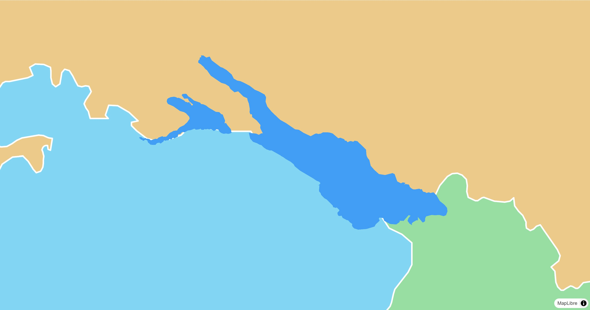

# Fill StyleLayer

The `FillStyleLayer` is either used by the map style or can be added to the map
programmatically to symbolize data on the map.

[](/demo/#/style-layers/fill)

## Basic Usage

```dart linenums="1" hl_lines="11-20"
late final MapController _controller;

@override
Widget build(BuildContext context) {
  return MapLibreMap(
      options: MapOptions(initCamera: .position(center: Geographic(lon: 9.17, lat: 47.68), zoom: 7)),
      onMapCreated: (controller) => _controller = controller,
      onStyleLoaded: (style) async {
        final geojsonPolygon =
        await rootBundle.loadString('assets/geojson/lake-constance.json');
        await style.sources.add(
          GeoJsonSource.data(id: 'LakeConstance', data: geojsonPolygon),
        );
        await style.layers.add(
          FillStyleLayer(
            id: 'geojson-fill',
            sourceId: 'LakeConstance',
            color: const .literal(Color(0xFF429EF5)),
          ),
        );
      }
  );
}
```

Check out
the [example app](https://github.com/josxha/flutter-maplibre/blob/main/examples/lib/style_layers_fill_page.dart)
to learn more.

## Style & Layout

Every property of the style spec is an optional parameter and a getter and
setter of the layer. See [Paint & Layout](paint-and-layout) and
[Expressions](expressions).

Read the [Paint & Layout](./paint-and-layout) chapter to learn more on this
topic. 