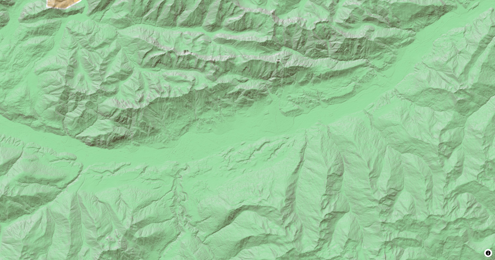

# Hillshade Style Layer

The `HillshadeStyleLayer` is either used by the map style or can be added to the map
programmatically to use DEM tiles. Those tiles are used to render elevation on 
the map.

[](/demo/#/style-layers/hillshade)

## Basic Usage

```dart linenums="1" hl_lines="9-20"
late final MapController _controller;

@override
Widget build(BuildContext context) {
  return MapLibreMap(
      options: MapOptions(center: Geographic(lon: 9.17, lat: 47.68)),
      onMapCreated: (controller) => _controller = controller,
      onStyleLoaded: (style) async {
        const hillshade = RasterDemSource.url(
          id: _sourceId,
          url: 'https://demotiles.maplibre.org/terrain-tiles/tiles.json',
          tileSize: 256,
        );
        await style.sources.add(hillshade);
        final layer = HillshadeStyleLayer(
          id: _layerId,
          sourceId: _sourceId,
          shadowColor: const .literal([Color(0xFF473B24)]),
        );
        await style.layers.add(layer);
      }
  );
}
```

Check out
the [example app](https://github.com/josxha/flutter-maplibre/blob/v0.3.4/examples/lib/layers_hillshade_page.dart)
to learn more.

## Style & Layout

Every property of the style spec is an optional parameter and a getter and
setter of the layer. See [Paint & Layout](paint-and-layout) and
[Expressions](expressions).

Read the [Paint & Layout](./paint-and-layout) chapter to learn more on this
topic. 