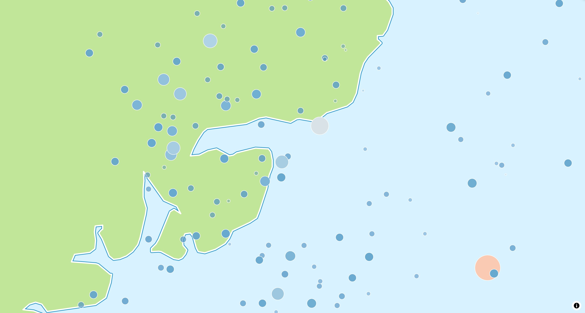
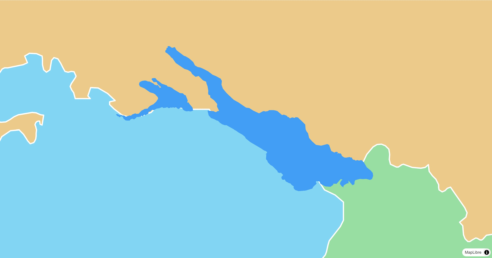
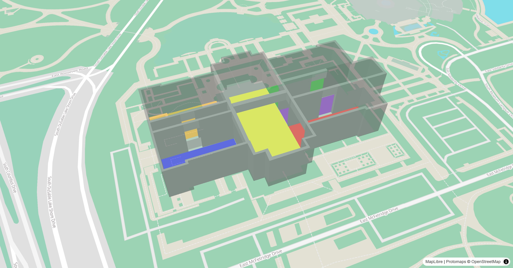
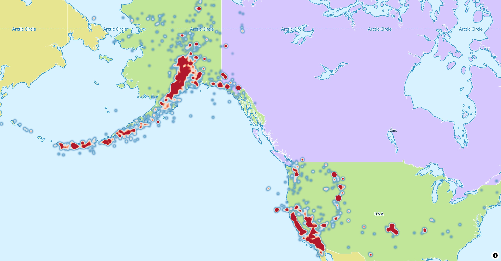
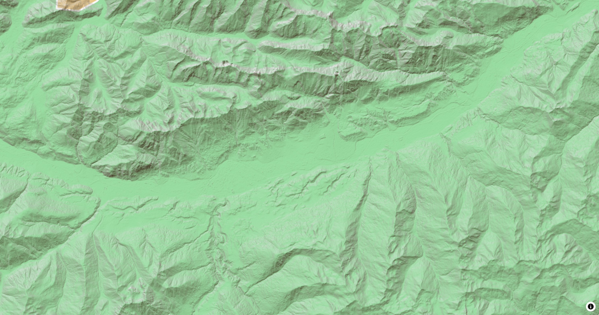
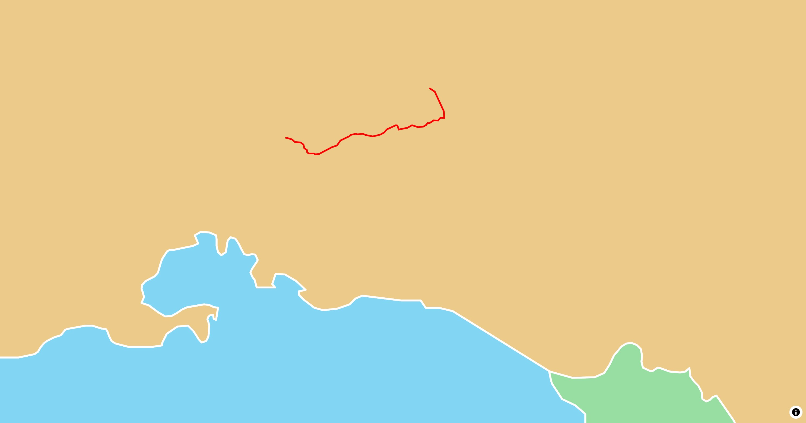
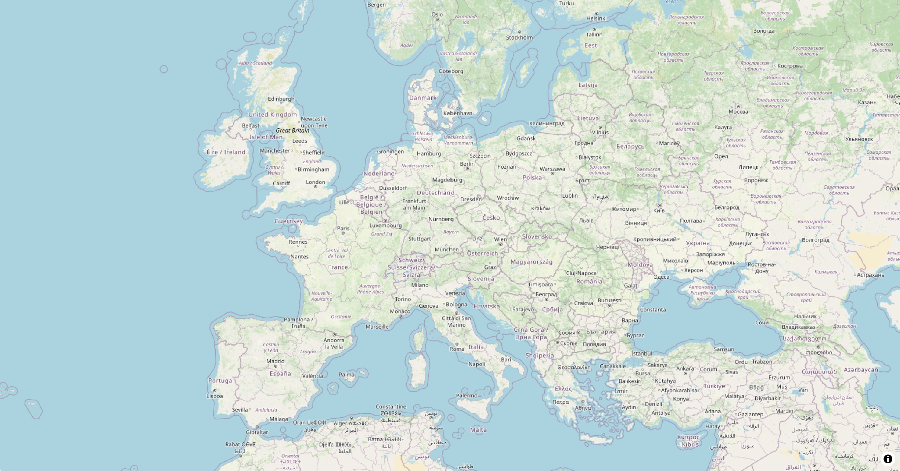
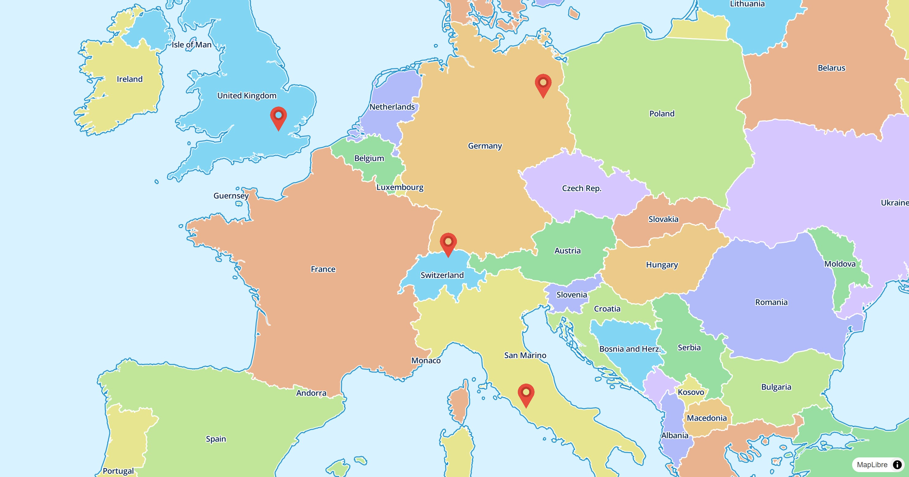

# Style Layers

Style layers draw the data of a [source](../sources/index.md) on the map. They
are the layers of the
[MapLibre style spec](https://maplibre.org/maplibre-style-spec/layers/), with
every paint and layout property as a typed parameter. Use them for data that
[annotation layers](../annotations/index.md) don't cover, or for large data
sets, as the map styles the features itself.

Add a source and a layer that uses it once the style has loaded:

```dart linenums="1" hl_lines="6-15"
@override
Widget build(BuildContext context) {
  return MapLibreMap(
    options: MapOptions(initCamera: .position(center: Geographic(lon: 9.17, lat: 47.68), zoom: 7)),
    onStyleLoaded: (style) async {
      await style.sources.add(
        const GeoJsonSource.url(
          id: 'earthquakes',
          url: 'https://maplibre.org/maplibre-gl-js/docs/assets/earthquakes.geojson',
        ),
      );
      await style.layers.add(
        CircleStyleLayer(id: 'earthquakes', sourceId: 'earthquakes'),
      );
    },
  );
}
```

`style.layers` also holds the layers of the loaded style. Read them by id,
change their properties, move or remove them:

```dart
final roads = style.layers['roads'];
roads?.visible = false;
style.layers.move('route', belowLayerId: 'labels');
await style.layers.remove('earthquakes');
```

See [Paint & Layout](paint-and-layout.md) for the properties,
[Expressions](expressions.md#layers-on-the-map) for updates at runtime and
[Click and Hover](click-and-hover.md) for events on the features of a layer.

## Circle

[](../../demo/#/style-layers/circle)

A `CircleStyleLayer` draws a circle for each point. Use it for point data such
as measurements or events.

```dart
await style.layers.add(
  CircleStyleLayer(
    id: 'earthquakes',
    sourceId: 'earthquakes',
    radius: const .literal(6),
    color: const .literal(Colors.red),
  ),
);
```

See the
[example app](https://github.com/josxha/flutter-maplibre/blob/main/examples/lib/style_layers_circle_page.dart).

## Fill

[](../../demo/#/style-layers/fill)

A `FillStyleLayer` fills polygons, optionally with an outline.

```dart
final geojson = await rootBundle.loadString('assets/geojson/lake-constance.json');
await style.sources.add(
  GeoJsonSource.data(id: 'lake', data: .text(geojson)),
);
await style.layers.add(
  FillStyleLayer(
    id: 'lake',
    sourceId: 'lake',
    color: const .literal(Color(0xFF429EF5)),
  ),
);
```

See the
[example app](https://github.com/josxha/flutter-maplibre/blob/main/examples/lib/style_layers_fill_page.dart).

## Fill Extrusion

[](../../demo/#/style-layers/fill-extrusion)

A `FillExtrusionStyleLayer` extrudes polygons to 3D shapes, such as buildings.
Tilt the map to see their height.

```dart
await style.sources.add(
  const GeoJsonSource.url(
    id: 'rooms',
    url: 'https://maplibre.org/maplibre-gl-js/docs/assets/indoor-3d-map.geojson',
  ),
);
await style.layers.add(
  FillExtrusionStyleLayer(
    id: 'rooms',
    sourceId: 'rooms',
    color: .get('color').convertToColor(),
    height: .get('height').asNumber(),
    base: .get('base_height').asNumber(),
    opacity: const .literal(0.5),
  ),
);
```

See the
[example app](https://github.com/josxha/flutter-maplibre/blob/main/examples/lib/style_layers_fill_extrusion_page.dart).

## Heatmap

[](../../demo/#/style-layers/heatmap)

A `HeatmapStyleLayer` shows the density of points as a color gradient.

```dart
await style.layers.add(
  HeatmapStyleLayer(id: 'earthquakes-heat', sourceId: 'earthquakes'),
);
```

See the
[example app](https://github.com/josxha/flutter-maplibre/blob/main/examples/lib/style_layers_heatmap_page.dart).

## Hillshade

[](../../demo/#/style-layers/hillshade)

A `HillshadeStyleLayer` shades terrain from the elevation tiles of a
[`RasterDemSource`](../sources/tiles.md#raster-dem-tiles).

```dart
await style.sources.add(
  const RasterDemSource.url(
    id: 'terrain',
    url: 'https://demotiles.maplibre.org/terrain-tiles/tiles.json',
    tileSize: 256,
  ),
);
await style.layers.add(
  HillshadeStyleLayer(
    id: 'hillshade',
    sourceId: 'terrain',
    shadowColor: const .literal([Color(0xFF473B24)]),
  ),
);
```

`ColorReliefStyleLayer` colors the same tiles by elevation.

See the
[example app](https://github.com/josxha/flutter-maplibre/blob/main/examples/lib/style_layers_hillshade_page.dart).

## Line

[](../../demo/#/style-layers/line)

A `LineStyleLayer` draws lines and the outlines of polygons, such as routes,
roads or borders.

```dart
final geojson = await rootBundle.loadString('assets/geojson/path.json');
await style.sources.add(
  GeoJsonSource.data(id: 'path', data: .text(geojson)),
);
await style.layers.add(
  LineStyleLayer(
    id: 'path',
    sourceId: 'path',
    color: const .literal(Color(0xFFFF0000)),
    width: const .literal(3),
  ),
);
```

See the
[example app](https://github.com/josxha/flutter-maplibre/blob/main/examples/lib/style_layers_line_page.dart).

## Raster

[](../../demo/#/style-layers/raster)

A `RasterStyleLayer` shows the image tiles of a
[`RasterSource`](../sources/tiles.md#raster-tiles), such as satellite imagery,
or an [image source](../sources/media.md).

```dart
await style.sources.add(
  const RasterSource.tiles(
    id: 'osm',
    tiles: ['https://tile.openstreetmap.org/{z}/{x}/{y}.png'],
    maxZoom: 20,
    tileSize: 256,
    attribution: '© <a href="https://www.openstreetmap.org/copyright">OpenStreetMap contributors</a>',
  ),
);
await style.layers.add(RasterStyleLayer(id: 'osm', sourceId: 'osm'));
```

See the
[example app](https://github.com/josxha/flutter-maplibre/blob/main/examples/lib/style_layers_raster_page.dart).

## Symbol

[](../../demo/#/style-layers/symbol)

A `SymbolStyleLayer` draws icons and text labels. Add the icon image to the
style first:

```dart
final response = await http.get(Uri.parse(imageUrl));
await style.addImage('marker', response.bodyBytes);

await style.layers.add(
  SymbolStyleLayer(
    id: 'images',
    sourceId: 'points',
    iconImage: const .literal('marker'),
    iconSize: const .literal(0.08),
    iconAnchor: const .literal(IconAnchor.bottom),
  ),
);
```

See the
[example app](https://github.com/josxha/flutter-maplibre/blob/main/examples/lib/style_layers_symbol_page.dart).

## Background

A `BackgroundStyleLayer` fills the whole map with a color or a pattern. It
has no source.

```dart
await style.layers.add(
  BackgroundStyleLayer(id: 'background', color: const .literal(Colors.white)),
);
```
