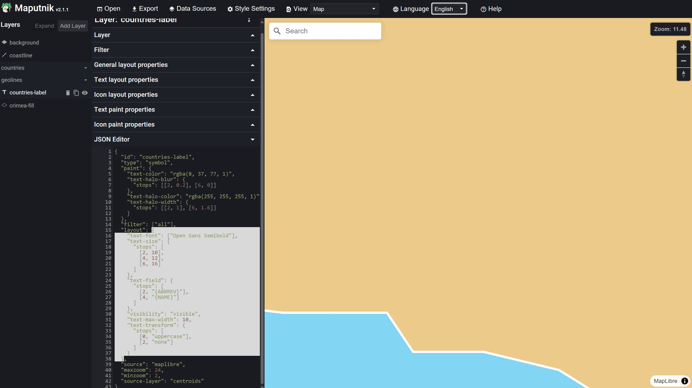

# Paint & Layout Properties

[Style Layers](index.md) have every paint and layout property of the style
spec, while the [annotation layers](../annotations/index.md) have a selection
of them. See
the [MapLibre Style Specification](https://maplibre.org/maplibre-style-spec/layers)
for all available properties for the different layers.

Every property is an optional parameter and a getter and setter of its layer
class, without the prefix of the layer type, so `line-width` is
`LineStyleLayer.width`. It takes an [Expression](expressions) for zoom level
dependent and data driven styling. A property with a transition also has one,
such as `colorTransition`:

```dart
final layer = LineStyleLayer(
  id: 'route',
  sourceId: 'route',
  width: const .literal(4),
  cap: const .literal(LineCap.round),
  colorTransition: const StyleTransition(duration: Duration(milliseconds: 500)),
);
```

`Expression.raw` takes the JSON of a single property, and `StyleLayer.fromJson`
the JSON of a whole layer, for example one copied from a style.

Expressions can be a bit tricky. In case you are not experienced, it is
recommended to build and test them in [Maputnik](https://maplibre.org/maputnik) first and copy them over.

[](https://maplibre.org/maputnik)