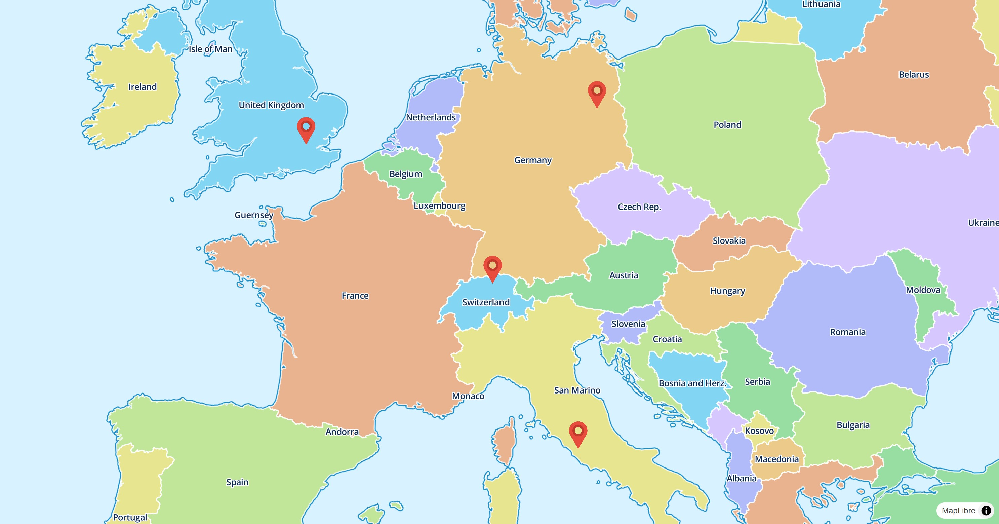

# Symbol Style Layer

The `SymbolStyleLayer` is either used by the map style or can be added to the map
programmatically to symbolize data on the map.

[](/demo/#/style-layers/symbol)

## Basic Usage

```dart linenums="1" hl_lines="14 17-22 25-36"
late final MapController _controller;

@override
Widget build(BuildContext context) {
  return MapLibreMap(
      options: MapOptions(center: Geographic(lon: 9.17, lat: 47.68)),
      onMapCreated: (controller) => _controller = controller,
      onStyleLoaded: (style) async {
        // load the image data
        final response = await http.get(Uri.parse(StyleLayersSymbolPage.imageUrl));
        final bytes = response.bodyBytes;

        // add the image to the map
        await style.addImage('marker', bytes);

        // add some points as GeoJSON source to the map
        await style.sources.add(
          const GeoJsonSource.data(
            id: 'points',
            data: _geoJsonString,
          ),
        );

        // display the image on the map
        await style.layers.add(
          SymbolStyleLayer(
            id: 'images',
            sourceId: 'points',
            iconImage: const .literal('marker'),
            iconSize: const .literal(0.08),
            iconAnchor: const .literal(IconAnchor.bottom),
          ),
        );
      }
  );
}
```

Check out
the [example app](https://github.com/josxha/flutter-maplibre/blob/v0.3.4/examples/lib/style_layers_symbol_page.dart)
to learn more.

## Style & Layout

Every property of the style spec is an optional parameter and a getter and
setter of the layer. See [Paint & Layout](paint-and-layout) and
[Expressions](expressions).

Read the [Paint & Layout](./paint-and-layout) chapter to learn more on this
topic. 