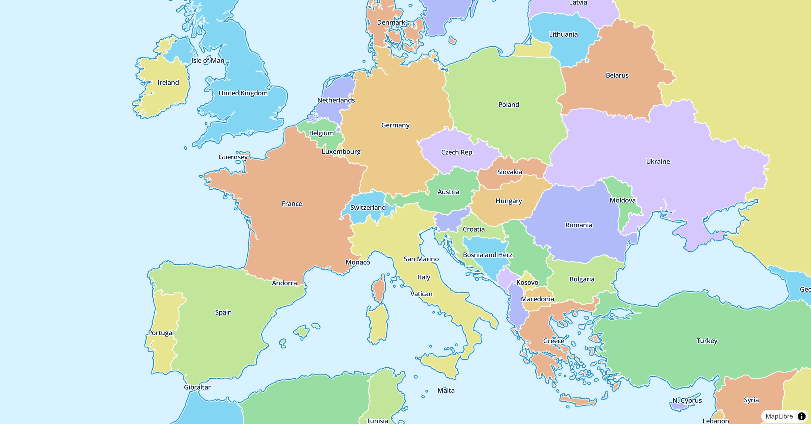
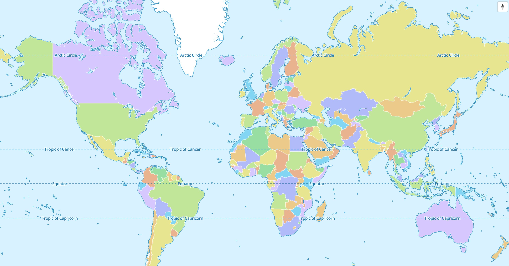
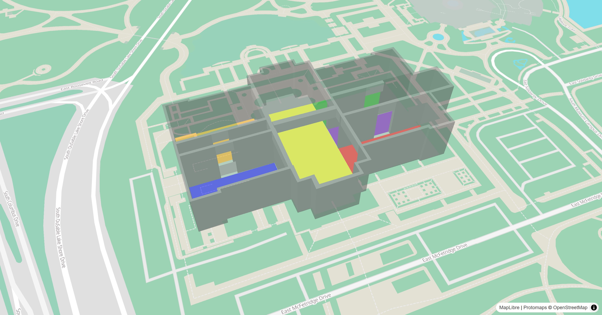
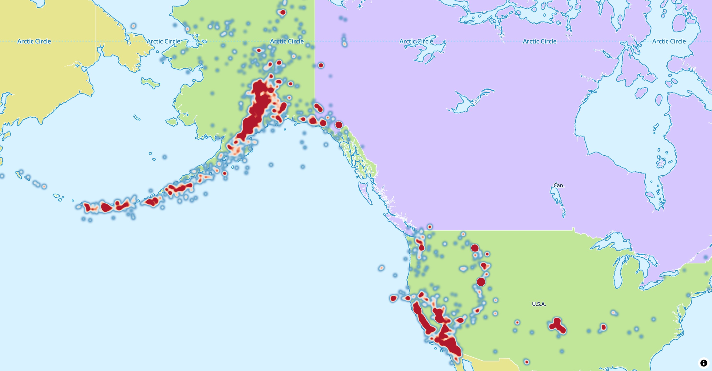
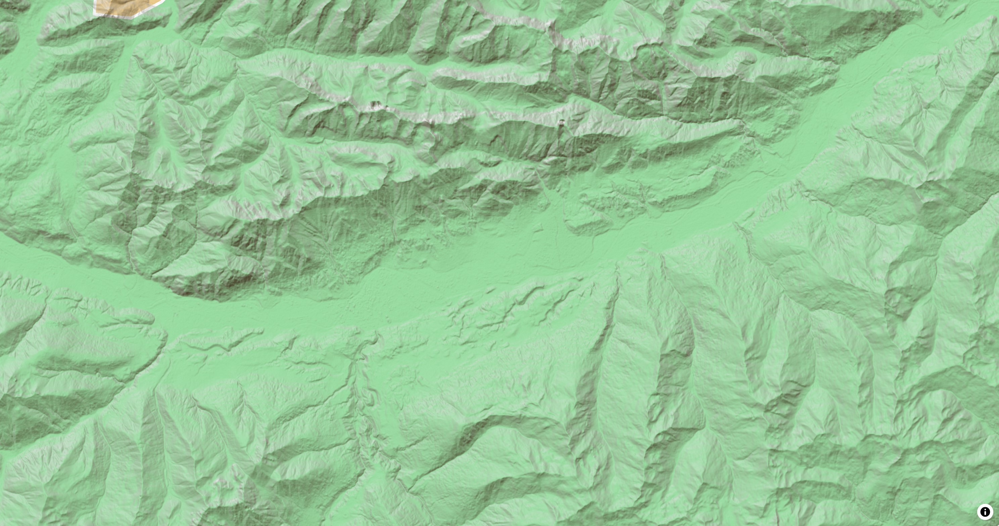
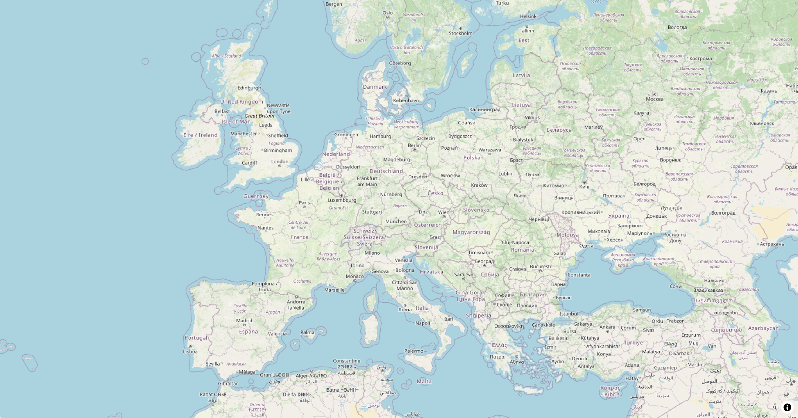
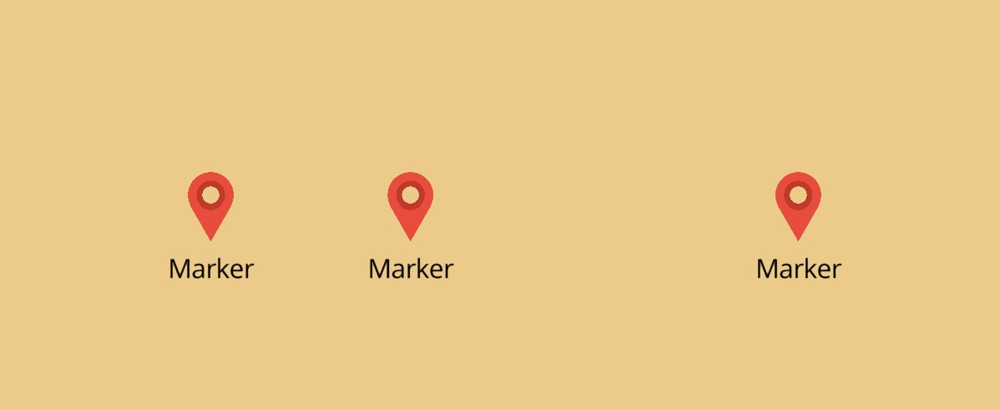
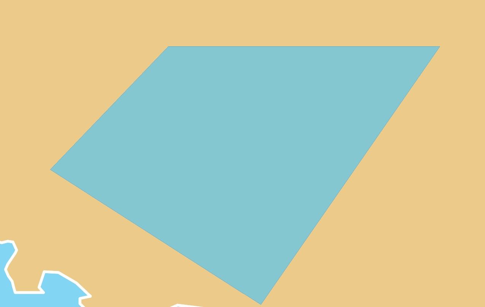
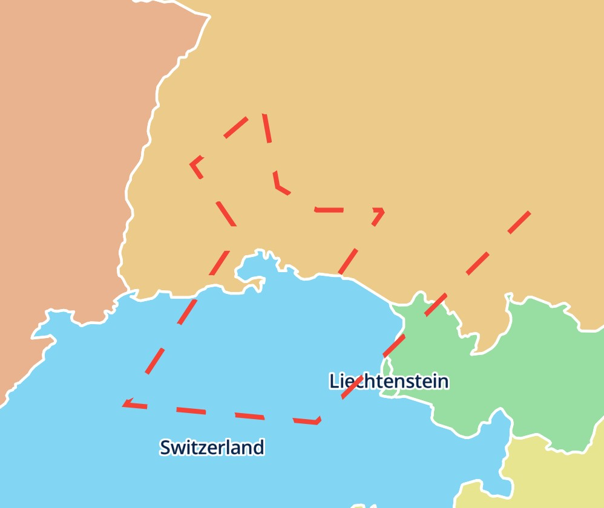
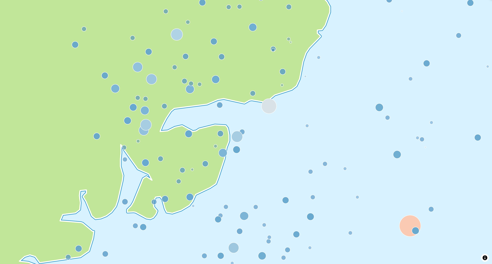

<div class="ml-hero" markdown>
<div markdown>

# MapLibre Flutter

<p class="ml-hero__tagline">
Interactive vector maps for Android, iOS, macOS, Windows, Linux and web.
Use any MapLibre or Mapbox compatible style from any tile provider or your own
server. `maplibre` needs no API key of its own and has no vendor lock-in.
</p>

<div class="ml-hero__buttons" markdown>
[Get started](docs/getting-started/setup.md){ .md-button .md-button--primary }
[Live demo](demo/){ .md-button }
[GitHub](https://github.com/josxha/flutter-maplibre){ .md-button }
</div>

<div class="ml-badges" markdown>
[](https://pub.dev/packages/maplibre)
[](https://pub.dev/packages/maplibre)
[](https://github.com/josxha/flutter-maplibre)
[](https://pub.dev/packages/maplibre)
</div>

</div>
<div class="ml-hero__image" markdown>
[](demo/)
</div>
</div>

<div class="grid cards" markdown>

-   :lucide-monitor-smartphone:{ .lg .middle } __Six platforms, one API__

    ---

    Android, iOS, macOS, Windows, Linux and web, with the same gestures and
    behavior on each of them.

    [:lucide-arrow-right: Platform setup](docs/getting-started/platforms.md)

-   :lucide-layers:{ .lg .middle } __Made for Flutter__

    ---

    Maps render into a Flutter `Texture` (an HTML element on web). Annotations
    are declarative layers
    that you update with `setState()`, and widgets compose with the map.

    [:lucide-arrow-right: Annotations](docs/annotations/index.md)

-   :lucide-zap:{ .lg .middle } __Fast interop__

    ---

    The package calls MapLibre through FFI instead of platform channels, so
    the camera and the style layers can be read synchronously.

    [:lucide-arrow-right: Architecture](docs/contributing/architecture.md)

-   :lucide-paintbrush:{ .lg .middle } __The full style spec__

    ---

    Typed style layers, sources and expressions for vector and raster tiles,
    PMTiles, MBTiles, hillshading, heatmaps and 3D extrusions.

    [:lucide-arrow-right: Style layers](docs/style-layers/index.md)

-   :lucide-wifi-off:{ .lg .middle } __Offline maps__

    ---

    Download regions or only the tiles along a route, and cache what the map
    loads.

    [:lucide-arrow-right: Offline & Cache](docs/offline.md)

-   :lucide-scale:{ .lg .middle } __Open source__

    ---

    BSD-3-Clause licensed, with no usage fees. Choose a tile provider or host
    your own tiles.

    [:lucide-arrow-right: Compare packages](compare/index.md)

</div>

## Your first map { .ml-section-title }

<div class="ml-split" markdown>
<div markdown>

```dart
import 'package:maplibre/maplibre.dart';

MapLibreMap(
  options: MapOptions(
    style: MapStyle.url('https://demotiles.maplibre.org/style.json'),
    initCamera: .position(
      center: Geographic(lon: 9.17, lat: 47.68),
      zoom: 7,
    ),
  ),
  layers: [
    CircleLayer(
      points: [
        Feature(geometry: Point(Geographic(lon: 9.17, lat: 47.68))),
      ],
      color: const .literal(Colors.blue),
      radius: const .literal(12),
    ),
  ],
  children: const [MapScalebar(), MapCompass()],
)
```

</div>
<div markdown>



</div>
</div>

## What you can build { .ml-section-title }

<p class="ml-section-lead">
Every example runs in the <a href="demo/">live demo</a>, and its code is in the
<a href="https://github.com/josxha/flutter-maplibre/tree/main/examples/lib">example app</a>.
</p>

<div class="ml-gallery">
  <a href="demo/#/style-layers/fill-extrusion"><span>3D buildings</span></a>
  <a href="demo/#/style-layers/heatmap"><span>Heatmaps</span></a>
  <a href="demo/#/style-layers/hillshade"><span>Hillshading</span></a>
  <a href="demo/#/style-layers/raster"><span>Raster tiles</span></a>
  <a href="demo/#/layers/marker"><span>Markers</span></a>
  <a href="demo/#/layers/polygon"><span>Polygons</span></a>
  <a href="demo/#/layers/polyline"><span>Polylines</span></a>
  <a href="demo/#/style-layers/circle"><span>Circles</span></a>
</div>

## Platforms { .ml-section-title }

<div class="ml-platforms" markdown>

| Platform | Package           | Rendering                              |
|----------|-------------------|----------------------------------------|
| Android  | `maplibre_native` | OpenGL ES 3.0 (default) or Vulkan      |
| iOS      | `maplibre_native` | Metal                                  |
| macOS    | `maplibre_native` | Metal                                  |
| Windows  | `maplibre_native` | Vulkan, shared with Flutter via D3D11  |
| Linux    | `maplibre_native` | Vulkan, shared with Flutter via OpenGL |
| Web      | `maplibre_web`    | WebGL 2 (maplibre-gl-js)               |

</div>

You only add `maplibre` to your app; it picks the implementation for each
platform. See [Features](features/index.md) for what each platform supports.

## Contributing { .ml-section-title }

Contributions of any kind are welcome:

- Star the project on [GitHub](https://github.com/josxha/flutter-maplibre) and
  like it on [pub.dev](https://pub.dev/packages/maplibre).
- [Share what you built](https://github.com/josxha/flutter-maplibre/discussions/categories/show-and-tell)
  and give feedback.
- [Report bugs](https://github.com/josxha/flutter-maplibre/issues/new?labels=bug&template=1-bug.yml)
  or [request features](https://github.com/josxha/flutter-maplibre/issues/new?labels=feature&template=2-feature.yml).
- Chat with us in `#flutter-maplibre` on the [OpenStreetMap US Slack](https://slack.openstreetmap.us).
- Improve the code or the docs, see [Local development](docs/contributing/development.md).
- Sponsor the project on [GitHub Sponsors](https://github.com/sponsors/josxha)
  or [PayPal](https://www.paypal.com/paypalme/joschaeckert).

[](https://github.com/josxha/flutter-maplibre/graphs/contributors)

<div class="ml-cta" markdown>
[Get started](docs/getting-started/setup.md){ .md-button .md-button--primary }
[Read the docs](docs/index.md){ .md-button }
</div>
